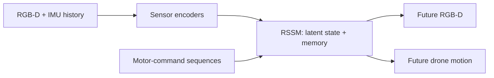

# Aerial World Model (airwm)

A simulation research project for a drone that explores an indoor room and learns to predict what it will see and how it will move under future flight commands.

The goal is to learn visible room geometry, appearance, and flight dynamics from RGB-D, IMU measurements, and motor-command histories, then use those predictions to guide further exploration.

**Status:** planning stage. This workspace currently contains the project documentation; simulation code, training pipelines, datasets, and trained models have not been added.

See [SIMULATION_PLAN.md](SIMULATION_PLAN.md) for the detailed experiment design, evaluation protocol, and references.

## Approach

Start with a **DreamerV3-style recurrent state-space model (RSSM)**. It combines current observations with recurrent memory, then predicts future observations and motion conditioned on action sequences.

The proposed model adds depth reconstruction and an auxiliary motion-prediction head to the Dreamer-style baseline. Simulator state provides motion targets and evaluation ground truth; it is excluded from the main world-model inputs.

After validating prediction, add **Plan2Explore-style exploration** using disagreement between learned predictors to seek informative experience. Persistent spatial memory follows as a separate extension for retaining room geometry across long turns, occlusions, and revisits.

## Planned simulation

| Component | Initial choice |
|---|---|
| Simulator | Isaac Lab 3.0.0 with Isaac Sim 6.2.0/PhysX and RTX rendering |
| Python environment | Conda `airwm`, Python 3.12, PyTorch 2.11.0 with CUDA 13.0 |
| Scene | One static furnished room |
| Robot | Quadrotor with per-motor thrust/torque, motor response, drag, and collisions |
| Sensors | RGB, depth, and IMU |
| Camera / world-model cadence | 64 × 64 images at 20 Hz |
| Physics / motor control | 200 Hz / 100 Hz |
| Hardware assumption | NVIDIA RTX GPU with at least 16 GB VRAM |
| Parallelism | One environment initially; increase after throughput and VRAM profiling |

The software versions are selected; the exact GPU, driver, and runtime compatibility still need validation. Initial data collection and neural-model training will run separately to manage GPU memory. See the [Conda setup and pinned versions](SIMULATION_PLAN.md#0-conda-environment-and-pinned-software) for installation commands and verification steps.

## First experiment

1. Validate stable flight and synchronized sensor/action logging in one room.
2. Collect varied trajectories with a conventional controller, including turns, acceleration, braking, altitude changes, and revisits.
3. Split complete flights into training, validation, and test sets.
4. Train the RSSM to reconstruct observations and predict motion.
5. Evaluate predictions on held-out flights without intermediate observation corrections.

The immediate learning milestone is:

> Given one second of camera/IMU history and a future motor-command sequence, predict the next two seconds of RGB-D observations and drone motion.

Compare against visual persistence and nominal physics, and change future commands from the same starting state to verify that the model responds to actions. The pilot dataset is approximately 100 flights of 30–60 seconds, with further collection guided by validation results.

## Roadmap

- [ ] Validate the Isaac Lab room, drone dynamics, and RGB-D/IMU logging.
- [ ] Collect and inspect the pilot flight dataset.
- [ ] Train and evaluate the RSSM prediction baseline.
- [ ] Add learned exploration and compare it with scripted sweeps at equal flight time.
- [ ] Add persistent spatial memory and evaluate revisits.
- [ ] Investigate adaptation to new rooms and changed drone parameters.

The initial model is specific to one room. Unobserved regions remain unknown, and generalization to new rooms requires separate experiments.

## Documentation

- [Simulation experiment plan](SIMULATION_PLAN.md): architecture, data collection, training, evaluation, exploration, and source references.

Environment setup commands are documented in the plan and have not been executed. Project-specific data collection and training commands will be added with runnable code.
