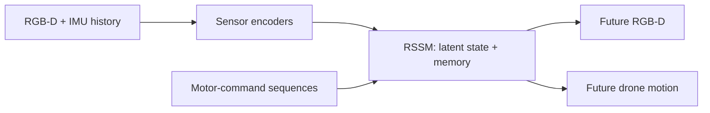

# Aerial World Model (airwm)

A simulation research project for a drone that explores an indoor room and learns to predict what it will see and how it will move under future flight commands.

The goal is to learn visible room geometry, appearance, and flight dynamics from RGB-D, IMU measurements, and motor-command histories, then use those predictions to guide further exploration.

**Status:** the initial pipeline works end to end. The pinned simulator stack is installed in `airwm`; CUDA execution and all 13 CPU tests pass. Hover, moving-flight RGB-D/IMU collection, a 10-step RSSM training run, and held-out evaluation have been validated. Full pilot-data collection and research training remain to be done.

See [SIMULATION_PLAN.md](SIMULATION_PLAN.md) for the detailed experiment design, evaluation protocol, and references.

## Approach

Start with a **DreamerV3-style recurrent state-space model (RSSM)**. It combines current observations with recurrent memory, then predicts future observations and motion conditioned on action sequences.



The proposed model adds depth reconstruction and an auxiliary motion-prediction head to the Dreamer-style baseline. Simulator state provides motion targets and evaluation ground truth; it is excluded from the main world-model inputs.

After validating prediction, add **Plan2Explore-style exploration** using disagreement between learned predictors to seek informative experience. Persistent spatial memory follows as a separate extension for retaining room geometry across long turns, occlusions, and revisits.

## Planned simulation

| Component | Initial choice |
|---|---|
| Simulator | Isaac Lab 3.0.0 with Isaac Sim 6.2.0/PhysX and RTX rendering |
| Python environment | Conda `airwm`, Python 3.12, PyTorch 2.11.0 with CUDA 13.0 |
| Scene | One static furnished room |
| Robot | Quadrotor with per-motor thrust/torque, motor response, drag, and collisions |
| Sensors | RGB, depth, and IMU |
| Camera / world-model cadence | 64 × 64 images at 20 Hz |
| Physics / motor control | 200 Hz / 100 Hz |
| Local hardware | NVIDIA GeForce RTX 5090, 32 GB VRAM; driver 580.178.04 |
| Parallelism | One environment initially; increase after throughput and VRAM profiling |

CUDA 13.0 and single-drone PhysX/RTX flight collection pass on this machine with the existing driver 580.178.04. Initial data collection and neural-model training run separately. See the [Conda setup and pinned versions](SIMULATION_PLAN.md#0-conda-environment-and-pinned-software) for the installation rationale.

## Setup and commands

Create a dedicated environment once, then install the pinned stack:

```bash
conda create -n airwm python=3.12 pip -y
conda activate airwm
AIRWM_DIRECT=1 bash setup/install.sh
bash setup/run.sh airwm doctor --output setup/environment/doctor.json
```

The environment is already installed on this machine; the commands above reproduce it. The installer uses a [version-and-hash lock](setup/environment/airwm-python-linux-64.lock) and [resolved overrides](setup/environment/isaaclab-resolved-overrides.txt), derived from the official [Isaac Lab overrides](setup/isaaclab-3.0-overrides.txt). Existing Conda environments are preserved.

`AIRWM_DIRECT=1` disables proxy variables only inside the installer. Omit it to use the current proxy configuration. An optional mirror can speed up ordinary PyPI packages while retaining official PyPI as a fallback and enforcing the locked hashes:

```bash
AIRWM_DIRECT=1 AIRWM_PYPI_MIRROR=https://pypi.tuna.tsinghua.edu.cn/simple bash setup/install.sh
```

This setup used direct downloads first, proxy retries where needed, and the Tsinghua mirror for remaining dependencies. Large wheels were downloaded with resume support and verified against official SHA-256 hashes. Global proxy and package-index settings were not changed.

This host's shell adds a CUDA 12.8 library directory to `LD_LIBRARY_PATH`. Run commands through `bash setup/run.sh airwm ...` to select `airwm` and remove that inherited path for the subprocess, using the new environment's packaged CUDA libraries. For example: `bash setup/run.sh airwm doctor --output setup/environment/doctor.json`.

The following commands reproduce the validated short workflow, then start the larger experiment. Use fresh output directories when repeating collection or training:

```bash
# One drone, local room geometry, no remote scene assets. Headless by default.
airwm collect --output data/hover --episodes 1 --seconds 5 --trajectory hover
airwm collect --output data/pilot --episodes 3 --seconds 8 --trajectory sweep

# Measure training VRAM independently of the simulator.
airwm profile --batch-size 16 --length 64 --output runs/profile.json

# Short pipeline check; use a fresh --run directory for each run.
airwm train --data data/pilot --run runs/smoke --steps 10 --batch-size 2
airwm evaluate --checkpoint runs/smoke/best.pt --output runs/smoke-evaluation

# Once flights and predictions are validated, collect the planned pilot dataset.
airwm collect --output data/pilot100 --episodes 100 --seconds 45 --seed 10
airwm train --data data/pilot100 --run runs/baseline --steps 10000 --batch-size 16
airwm evaluate --checkpoint runs/baseline/best.pt --output runs/baseline-evaluation
```

Add `--gui` to `collect` for a viewport. Collection and training are separate processes. A short training run verifies the pipeline; it does not establish useful learned predictions. Training-step count is a starting budget and must be adjusted from held-out results. Test predictions remain independent of training/validation flight splits.

The collector saves one HDF5 file per flight, camera intrinsics and conventions, tracking/depth diagnostics, and sampled device-wide VRAM. Physics and camera warmup occur before the episode clock starts, and every recorded camera pose is checked against the drone state. An interrupted file retains `.partial` and is excluded from training. Evaluation saves `prediction.png`, raw prediction arrays, and RGB/depth/motion errors at 0.5, 1, and 2 seconds, including a last-frame baseline and an action-change sensitivity check.

## Data and implementation boundaries

- Each flight contains `N` RGB-D/IMU observations and `N-1` motor-command blocks. `actions[t]` has shape `(5, 4)` and drives observation `t` to `t+1`.
- RGB is uint8; depth is metric distance to the image plane with a validity mask. IMU contains ideal body-frame specific acceleration and angular velocity, sampled at each image timestamp.
- State targets use world position, **xyzw** body-to-world quaternion, world linear velocity, and world angular velocity. Ground-truth state is excluded from the encoder inputs.
- The initial drone uses a box collision hull, 0.5 kg mass, explicit inertia, four motor force points, first-order motor lag, and linear/angular drag. These are assumed parameters, not a calibrated real drone.
- The RSSM has 21.4M parameters, categorical stochastic latents, unimix, and balanced KL/free-nats losses. RGB-D reconstruction and a motion head are project adaptations. This is a Dreamer-inspired predictor; actor/critic and Plan2Explore are not implemented yet.
- Evaluation reports velocity, per-frame relative pose, and integrated pose errors. The nominal rigid-body baseline receives the last ground-truth state and known physical parameters; it omits contacts and PhysX solver details. Learned pose increments are anchored at the last ground-truth pose only for evaluation. Motion-head ablations and revisit experiments remain future work.

## Development checks

```bash
python -m pytest -q
```

The CPU test suite covers hover/motor mixing, motor lag, IMU conventions, timestamp/action alignment, flight splitting, gradient flow, action sensitivity, pose composition, nominal dynamics, and offline checkpoint/evaluation plumbing. Synthetic fixtures are test data only.

The [pinned-environment training profile](setup/environment/profile.json) measured **1.89 GiB peak tensor memory / 2.25 GiB reserved** for the 21.4M-parameter model, BF16, batch 16, and sequence length 64. This synthetic forward/backward/Adam benchmark excludes Isaac Sim and does not measure prediction quality. Installed versions and CUDA checks are recorded in [doctor.json](setup/environment/doctor.json).

The [local runtime validation report](setup/environment/validation.json) records:

- A five-second hover with 101 observations, no collisions, and measured wall depth 2.820000 m versus the expected 2.82 m.
- Three eight-second moving flights with 483 observations, no collisions, valid depth throughout, and 50 ms observation intervals. Mean tracking errors were 0.20–0.31 m.
- A controlled floor-contact probe detected a collision and ended the flight at 1.9 seconds, with the final collision flag saved.
- About 21.7 camera frames per wall-clock second during moving-flight collection, excluding simulator startup. Peak **device-wide** GPU usage was 6.78 GiB, including other applications.
- A 10-step training smoke test and finite held-out RGB/depth/motion metrics. This is a pipeline check, not evidence of useful learned predictions.

Local generated artifacts: [flight preview](runs/validation/sweep-preview.png), [checkpoint](runs/validation/smoke01/best.pt), and [prediction preview](runs/validation/evaluation01/prediction.png). The validated flight data is in `data/validation/sweep04`. Earlier diagnostic collections with reset issues are quarantined or incomplete and are excluded from training.

Simulator validation used the documented CLI and script-file launches. One inline `python -c` diagnostic crashed before simulator startup; its cause was not isolated, and the script-file version passed.

## First experiment

1. Validate stable flight and synchronized sensor/action logging in one room.
2. Collect varied trajectories with a conventional controller, including turns, acceleration, braking, altitude changes, and revisits.
3. Split complete flights into training, validation, and test sets.
4. Train the RSSM to reconstruct observations and predict motion.
5. Evaluate predictions on held-out flights without intermediate observation corrections.

The immediate learning milestone is:

> Given one second of camera/IMU history and a future motor-command sequence, predict the next two seconds of RGB-D observations and drone motion.

Compare against visual persistence and nominal physics, and change future commands from the same starting state to verify that the model responds to actions. The pilot dataset is approximately 100 flights of 30–60 seconds, with further collection guided by validation results.

## Roadmap

- [x] Implement the collection, storage, RSSM training, and prediction interfaces.
- [x] Verify CPU tests and measure synthetic training memory on the RTX 5090.
- [x] Finish the pinned simulator installation and validate the new CUDA environment.
- [x] Validate the Isaac Lab room, drone dynamics, and RGB-D/IMU logging.
- [x] Run a short training/checkpoint/held-out evaluation smoke test.
- [ ] Collect and inspect the pilot flight dataset.
- [ ] Train and evaluate the RSSM prediction baseline.
- [ ] Add learned exploration and compare it with scripted sweeps at equal flight time.
- [ ] Add persistent spatial memory and evaluate revisits.
- [ ] Investigate adaptation to new rooms and changed drone parameters.

The initial model is specific to one room. Unobserved regions remain unknown, and generalization to new rooms requires separate experiments.

## Documentation

- [Simulation experiment plan](SIMULATION_PLAN.md): architecture, data collection, training, evaluation, exploration, and source references.

Setup results and remaining research milestones are recorded in the [simulation plan](SIMULATION_PLAN.md).
